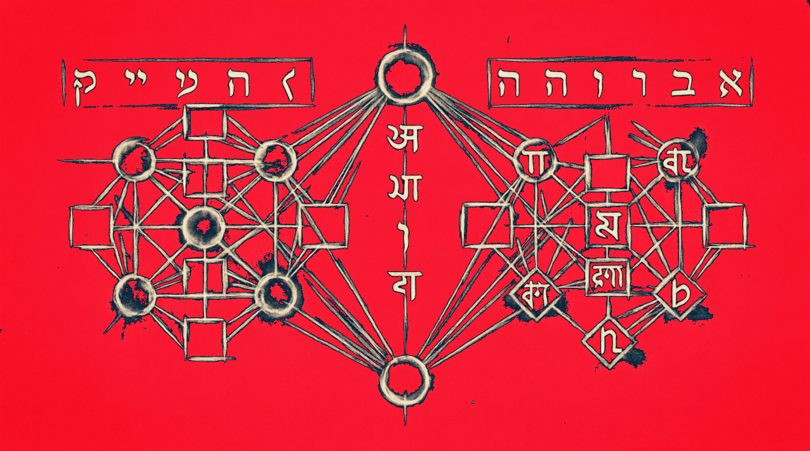

<div align="center">
  <h1>exoterik_OS</h1>
  <p><b>a holographic OS derived via exoteric linguistic synthesis and sigil distillation</b></p>
  
  
  
  
</div>

<div align="center">
  
  
  
  
  
  
  
</div>

*OMNIA SUNT PARACONSISTENTIA*

exoterik_OS is a holographic bare-metal operating system in Rust (no_std,
UEFI), derived by exoteric linguistic synthesis and sigil distillation, where
every kernel object carries an IG ALEPH structural type. It boots via
UEFI/OVMF into an IMASM VM with a native ALEPH (λ_ℵ) REPL and 52 builtin
programs; four primitive gates type-gate real kernel subsystems, and the 22
Hebrew letters serve as the kernel's primitive alphabet. Safety is a property
of the object: an operation runs only if its structural type passes the gate.
Ouroboricity tier O_∞ - ⊙ + Φ_±, the Special Frobenius, μ∘δ=id exactly.

## Contents

- Origin, Architecture (three-layer kernel objects, ergative-absolutive
  process model, phonological memory, Sefirot FS, three-layer IPC, command
  grammar, Φ_± → Φ_asym boot), Process Execution Model, ALEPH REPL,
  Type-Gated Kernel, OS imscription tuple, key theorems
- Corpus visualizations: animated call-graph CFGs for the five corpus
  engines (Voynich, Rohonc, Linear A, Emerald Tablet, ALEPH OS) plus the
  ob3ect opcode/descent/Python CFGs - build phase then Gaussian flow pulse
- 52 programs in `programs/` (46 .aleph + 6 .imasm/.asm), compiled in via
  `build.rs` and seeded into ALFS on first boot

## Build & run

Requires Rust nightly, the `x86_64-unknown-none` target, QEMU, OVMF, mtools:

```bash
rustup default nightly
rustup target add x86_64-unknown-none --toolchain nightly
cargo build --release
./build_bootimage.sh
./run.sh           # graphical, UEFI GOP framebuffer, Hebrew bitmap glyphs
./run.sh --serial  # serial, text-only via stdio
```

`run.sh` creates `alfs.img` (32 MB) on first launch and seeds all 52
programs; `rm alfs.img && ./run.sh` starts fresh. Boot: heap init → UEFI
framebuffer → interrupts (Φ_± → Φ_asym) → subsystem validation → ALEPH
init (22-letter types) → type-gate `assert!()` verification → holographic
monitor spawn → timer registration → ALFS mount → `exOS>` shell.

Full 996-line original (theorems, REPL commands, gate tables, visualizations)
is preserved in `README_backups/exOS_README.md`. Unlicense.

$\mu\circ\delta = \mathrm{id}$
